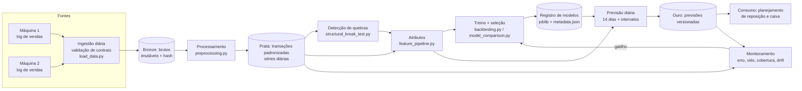

# Arquitetura para produção

Esta é uma arquitetura **tecnicamente viável e proporcional ao problema**. São poucas séries diárias de baixo volume, então ela foi desenhada em lote (batch) e não em streaming. O código deste repositório já é o núcleo do pipeline de treino e inferência. O que segue descreve como operá-lo.

## 1. Visão geral

## 2. Componentes

| Etapa | Implementação atual | Em produção |
|---|---|---|
| **Entrada e atualização** | CSV versionado em `data/raw` com SHA-256 (`MANIFEST.json`) | exportação diária dos logs das máquinas para um *bucket* (S3/GCS/Blob), particionado por máquina e data; arquivos imutáveis |
| **Validação** | `validar_bruto`: colunas, tipos, `money > 0`, domínio de `cash_type`, coerência `date` × `datetime` | o mesmo contrato roda antes de qualquer processamento; uma violação bloqueia a carga e gera alerta, sem descarte silencioso |
| **Processamento** | `preprocessing.py`: padronização, calendário contínuo, semântica de zeros, Total = M1 + M2 | tarefa diária idempotente que reprocessa a janela dos últimos 7 dias, para absorver vendas que chegam com atraso |
| **Quebras** | `DetectorQuebras`: Binseg + BIC refeito com os dados até a origem | roda a cada execução; uma quebra nova é registrada como evento e dispara revisão (ver §5) |
| **Atributos** | `ConstrutorAtributos`, com testes de vazamento | os mesmos atributos no treino e na inferência; o teste de vazamento roda no CI |
| **Treino e seleção** | 6 modelos, validação interna, backtest de 11 origens, escore de seleção | retreino semanal (domingo à noite) ou por gatilho; seleção pelo mesmo escore |
| **Armazenamento de modelos** | `models/*.joblib` + `*_metadata.json` (hash dos dados e da configuração, janela de treino, especificação) | registro de modelos (ex.: MLflow) com estágios *staging* → *production* |
| **Previsão** | `etapa_previsoes`: 14 dias e intervalos de 80/95% | tarefa diária às 6h; grava a tabela de previsões com `data_previsao`, `data_alvo`, `versao_modelo`, `versao_dados` |
| **Disponibilização** | CSV e gráficos em `reports/forecasts/` | tabela no *data warehouse* + painel (ex.: Power BI/Looker); API de leitura só se houver consumo sistêmico |
| **Orquestração** | `python -m src.pipeline` (etapas encadeadas, log em `logs/`) | Airflow, Prefect ou o agendador da nuvem; cada etapa do pipeline vira uma tarefa |

**Por que batch e por que estes modelos:**
- O volume é de dezenas de transações por dia, e as decisões (reposição, caixa) são diárias ou semanais.
- Os modelos estatísticos treinam em segundos. A Random Forest leva cerca de 30 s por série, com seleção.
- O pipeline completo, com o backtest, cabe em ~10 minutos numa única máquina. Não há necessidade de GPU, cluster ou streaming.

## 3. Monitoramento de performance

Diariamente, quando o valor real do dia chega:

| Métrica | Janela | Alerta |
|---|---|---|
| WAPE e MAE por máquina e alvo | móvel de 14 e 28 dias | WAPE de 28 dias > 1,25 × WAPE do backtest do modelo em produção |
| Viés (ME) acumulado | 28 dias | \|ME\| / média > 15% (o mesmo limite usado na seleção) |
| Cobertura do intervalo de 80% | 28 dias | < 65% ou > 95% (intervalo descalibrado) |
| Comparação com o baseline | 28 dias | o modelo pior que a Média 4 semanas em 3 blocos de 14 dias consecutivos |
| Anomalia diária | dia | observado fora do intervalo de 95%; registra possível falha ou fechamento (ver análise de zeros) |

O **piso de ruído de contagem** (WAPE de ~17–32% nas vendas: M1 21%, M2 32%, Total 17%) é a referência para não perseguir melhorias impossíveis. Um WAPE operacional perto do piso significa que o modelo está bom.

## 4. Detecção de drift

**Data drift** (mudança na distribuição das entradas), semanal:
- PSI ou teste KS da demanda diária, do ticket médio e da distribuição horária (proporção manhã/noite) contra as 8 semanas anteriores. PSI > 0,2 gera alerta.
- Teste χ² do mix de produtos e da proporção de meios de pagamento.
- Novos produtos, preços fora da tabela vigente e horários fora da janela habitual (como em mai/2024).
- **Esquema**: uma coluna nova ou ausente (como a falta de `card` na M2) bloqueia o pipeline.

**Concept drift** (mudança na relação entre entradas e alvo):
- **Detecção online de quebra**: o `DetectorQuebras` roda a cada execução só com o passado. O projeto mostrou que a quebra de fev/2025 só fica detectável com ~3–4 semanas de dados novos. Para reduzir esse atraso, somar um CUSUM sobre os resíduos de previsão (detecta deslocamentos persistentes de média em poucos dias).
- **Erro relativo ao baseline**: se a Média 4 semanas passa a vencer o modelo de forma consistente, o padrão aprendido deixou de valer.
- **Eventos operacionais conhecidos** (mudança de horário, preço, nova máquina) devem entrar como **dados de entrada**, e não ser redescobertos pelo modelo. Recomenda-se um cadastro de eventos operacionais.

## 5. Critérios de retreino

| Gatilho | Ação |
|---|---|
| Calendário: semanal | retreino com os mesmos hiperparâmetros e reavaliação no último bloco de 14 dias |
| Calendário: mensal | retreino completo com seleção (janelas, hiperparâmetros) e backtest |
| Alerta de performance (§3) por 7 dias seguidos | retreino completo antecipado |
| Quebra estrutural detectada ou evento operacional cadastrado | retreino completo; a dummy da nova quebra entra como candidata |
| Nova máquina | começa com o modelo plano (nível + intervalo largo), como a M2; os modelos com estrutura só entram depois de ~8 semanas, quando a validação interna tem dobras suficientes |

Um modelo novo só substitui o atual se não for pior no backtest (MASE médio) **e** no último bloco. Isso é uma *shadow evaluation*: o modelo novo roda em paralelo por 1–2 semanas antes da promoção.

## 6. Versionamento e rastreabilidade

- **Código**: Git, com CI (`.github/workflows/tests.yml`) rodando os testes de dados, de vazamento, de modelos e de previsões a cada *push*.
- **Configuração**: `config/config.yaml`. O hash entra nos metadados de cada modelo.
- **Dados**: brutos imutáveis com SHA-256; o processamento é determinístico (sementes fixas).
- **Modelos**: arquivo `joblib` + `metadata.json` (série, alvo, especificação, janela de treino, hash de dados e configuração, data de geração) + `registro_modelos.csv`.
- **Previsões**: cada linha guarda a versão do modelo e dos dados, o que permite reconstruir qualquer previsão passada.

## 7. Escalabilidade e manutenção

- **Mais máquinas**: o código já trata a série como parâmetro, e os modelos são independentes por série, então a execução paraleliza trivialmente (joblib localmente; tarefas paralelas no orquestrador). Para dezenas ou centenas de máquinas, vale testar um **modelo global** (uma única árvore ou rede treinada em todas as séries, com a máquina como atributo). O projeto mostrou que, com só 2 máquinas e uma delas com 30 dias, o desenho conjunto piora a M2 (`modelagens_testes`, seção 8.3). Com muitas séries, a relação se inverte, e é aí que N-BEATS/NHITS passam a valer.
- **Granularidade horária**: só com volume maior. Hoje há menos de 1 venda por hora, e o ruído domina.
- **Manutenção**:
  - funções pequenas, documentadas e testadas;
  - parâmetros na configuração;
  - logs em arquivo;
  - um teste para cada invariante de negócio (Total = M1 + M2, zero de demanda ⇔ zero de receita, ausência de vazamento).
